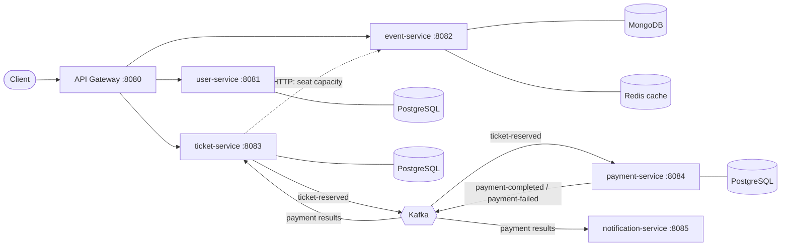

# Billetterie

An event ticketing platform built as a set of microservices. Organizers publish events with a limited number of seats, users reserve tickets, and the system stays correct when many people try to book the last seats at the same time.


## Architecture



Every service owns its database. Services discover each other through Eureka (`discovery-server`, port 8761) and communicate either over HTTP or through Kafka events.

| Service | Responsibility | Storage |
|---|---|---|
| `user-service` | Registration, login (JWT), profile | PostgreSQL |
| `event-service` | Events created by organizers, search by city and date | MongoDB, Redis cache |
| `ticket-service` | Reservations, cancellations, seat stock, concurrency control | PostgreSQL |
| `payment-service` | Simulated payments, driven by Kafka | PostgreSQL |
| `notification-service` | Simulated confirmation messages, driven by Kafka | none |
| `api-gateway` | Single entry point and routing | none |
| `discovery-server` | Service discovery (Eureka) | none |

## What happens when a user books a ticket

1. `POST /tickets/reserve` reaches the `ticket-service` through the gateway, with a JWT.
2. In **one database transaction**, the seat count is decremented, the ticket is saved as `RESERVED`, and a `ticket-reserved` message is written to an outbox table.
3. A relay publishes the outbox messages to Kafka.
4. The `payment-service` consumes the message, decides (simulated), stores the result and publishes `payment-completed` or `payment-failed`.
5. The `ticket-service` reacts: the ticket becomes `PAID`, or it is cancelled and the seat goes back to the stock.
6. The `notification-service` reacts too and sends a (simulated) message to the user.

## Technical highlights

- **No overselling under concurrency.** The seat stock uses optimistic locking (`@Version`) with a bounded retry loop. An integration test fires 50 simultaneous buyers at 5 seats and checks that exactly 5 tickets exist. The test was written first and failed (50 tickets sold for 5 seats) before the fix.
- **Atomic stock creation.** The first reservations of a brand new event race to create its stock row. This is handled with `INSERT ... ON CONFLICT DO NOTHING`, after a first attempt based on catching exceptions proved fragile in tests.
- **Transactional outbox.** The ticket and its Kafka message are saved in the same transaction, so a ticket never exists without its message, and a failed reservation never leaves a message behind. If Kafka is down, reservations keep working and messages are sent when it comes back.
- **Idempotent consumers.** Kafka can deliver a message twice. A payment is unique per ticket (database constraint), a duplicate result never releases a seat twice, and notifications ignore recently seen tickets.
- **Cache-aside with eviction.** `GET /events/{id}` is cached in Redis (10 minutes), the entry is evicted when the event is updated, and a Redis outage never breaks the service.
- **Stateless security.** Services validate the same signed JWT (HS256) without calling the `user-service`. Passwords are hashed with BCrypt, login errors do not reveal which emails exist, and users cannot change their own role through the profile endpoint.
- **Testing.** Unit tests (Mockito) and integration tests running against real PostgreSQL, MongoDB, Redis and Kafka containers (Testcontainers). A GitHub Actions workflow per service runs the tests on every pull request and publishes the Docker image on merge.

## Tech stack

Java 25, Spring Boot 4, Spring Security (JWT resource server), Spring Data JPA and MongoDB, Spring Cloud (Gateway, Eureka), Spring for Apache Kafka, Redis, PostgreSQL, Docker and Docker Compose, GitHub Actions, JUnit 5, Mockito, Testcontainers.

## Run it locally

Requirements: Docker Desktop.

```bash
git clone https://github.com/yassineelk13/ticketing.git
cd ticketing
cp .env.example .env
```

Edit `.env` and set `JWT_SECRET` to a random string of at least 32 characters (it must stay private, never commit it). Then:

```bash
docker compose up -d --build
```

The first build downloads dependencies and takes a few minutes. When `docker compose ps` shows every container up, open the Eureka dashboard at <http://localhost:8761> to see the registered services. Everything is reachable through the gateway on port 8080.

## Try it

Bash syntax (on Windows use Git Bash, or import the requests into Postman).

```bash
# 1. Register an organizer and a user (the role is chosen at registration, a demo simplification)
curl -X POST localhost:8080/users/register -H "Content-Type: application/json" \
  -d '{"email":"organizer@example.com","password":"password123","firstName":"Olivia","lastName":"Organizer","role":"ORGANIZER"}'
curl -X POST localhost:8080/users/register -H "Content-Type: application/json" \
  -d '{"email":"user@example.com","password":"password123","firstName":"Ulysse","lastName":"User","role":"USER"}'

# 2. Log in as each one and keep the accessToken from the response
curl -X POST localhost:8080/users/login -H "Content-Type: application/json" \
  -d '{"email":"organizer@example.com","password":"password123"}'
export ORG_TOKEN=...
curl -X POST localhost:8080/users/login -H "Content-Type: application/json" \
  -d '{"email":"user@example.com","password":"password123"}'
export USER_TOKEN=...

# 3. The organizer creates an event with 2 seats and note its id
curl -X POST localhost:8080/events -H "Authorization: Bearer $ORG_TOKEN" -H "Content-Type: application/json" \
  -d '{"title":"Open air concert","description":"Summer night","type":"CONCERT","city":"Agadir","venue":"Theatre de Verdure","startDate":"2030-07-20T20:00:00Z","totalSeats":2,"attributes":{"artist":"Stormy"}}'

# 4. The user reserves three times: 201, 201, then 409 (sold out)
curl -X POST localhost:8080/tickets/reserve -H "Authorization: Bearer $USER_TOKEN" -H "Content-Type: application/json" \
  -d '{"eventId":"<event id>"}'

# 5. A few seconds later the payment result has been applied
curl localhost:8080/tickets/my-tickets -H "Authorization: Bearer $USER_TOKEN"
```

Payments are simulated and 20% of them are declined (`PAYMENT_FAILURE_RATE`). A declined payment cancels the ticket and releases the seat. The notification messages appear in the logs: `docker compose logs notification-service`.

## API summary (through the gateway)

| Method and path | Access | Description |
|---|---|---|
| `POST /users/register`, `POST /users/login` | public | Create an account, get a JWT |
| `GET /users/me`, `PUT /users/me` | authenticated | Read and update the profile |
| `GET /events/{id}`, `GET /events?city=&date=` | public | Read and search events |
| `POST /events`, `PUT /events/{id}` | organizer (owner for updates) | Create and update events |
| `POST /tickets/reserve` | authenticated | Reserve a seat |
| `GET /tickets/my-tickets` | authenticated | List my tickets |
| `DELETE /tickets/{id}` | authenticated (owner) | Cancel a ticket and release the seat |

## Tests

```bash
cd ticket-service
./mvnw test
```

Integration tests need Docker running (Testcontainers starts the databases and Kafka they need).

## Known limitations

These are deliberate simplifications of a learning project:

- The JWT is signed with a secret shared by all services (HS256). With more services, an asymmetric key pair would be preferable, so that only the `user-service` can sign tokens.
- A user cancelling a ticket while its payment is in flight is only logged: a real system would trigger a refund.
- Kafka messages carry the user id, not an email address, so notifications are simulated in the logs.
- Tables are created by Hibernate (`ddl-auto=update`). A production system would use migrations (Flyway).
- Single-node Kafka, no monitoring stack, and the default development credentials in `.env.example` are not meant for production.
- A cached event can be stale for up to ten minutes in a rare race between a read and an update.
- Event deletion is not supported: cancelling an event would need to refund the tickets already sold.

## Repository layout

```
.github/workflows/    one CI workflow per service
api-gateway/          Spring Cloud Gateway
discovery-server/     Eureka server
user-service/
event-service/
ticket-service/
payment-service/
notification-service/
docker-compose.yml    the whole stack
```